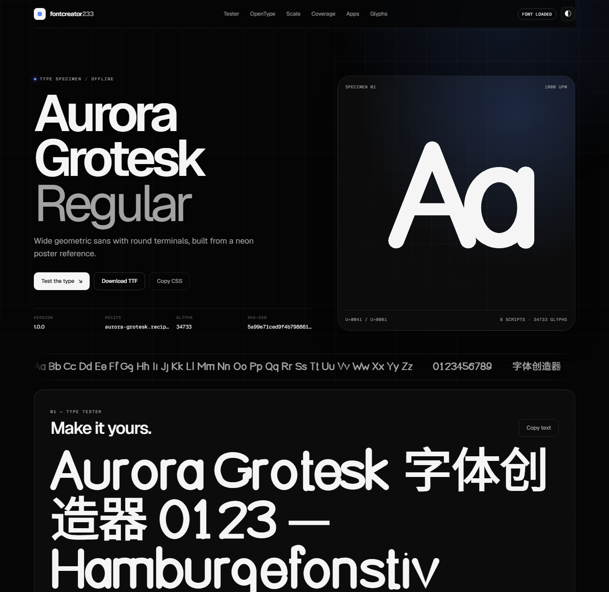
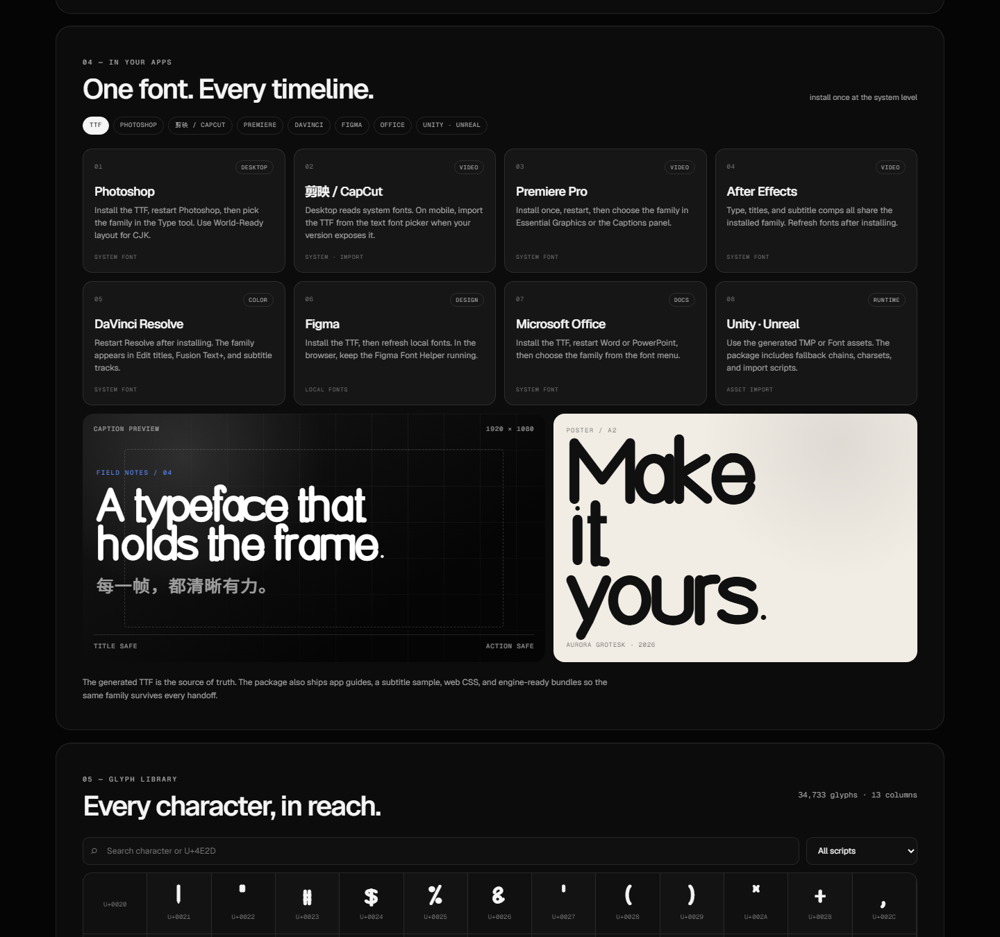
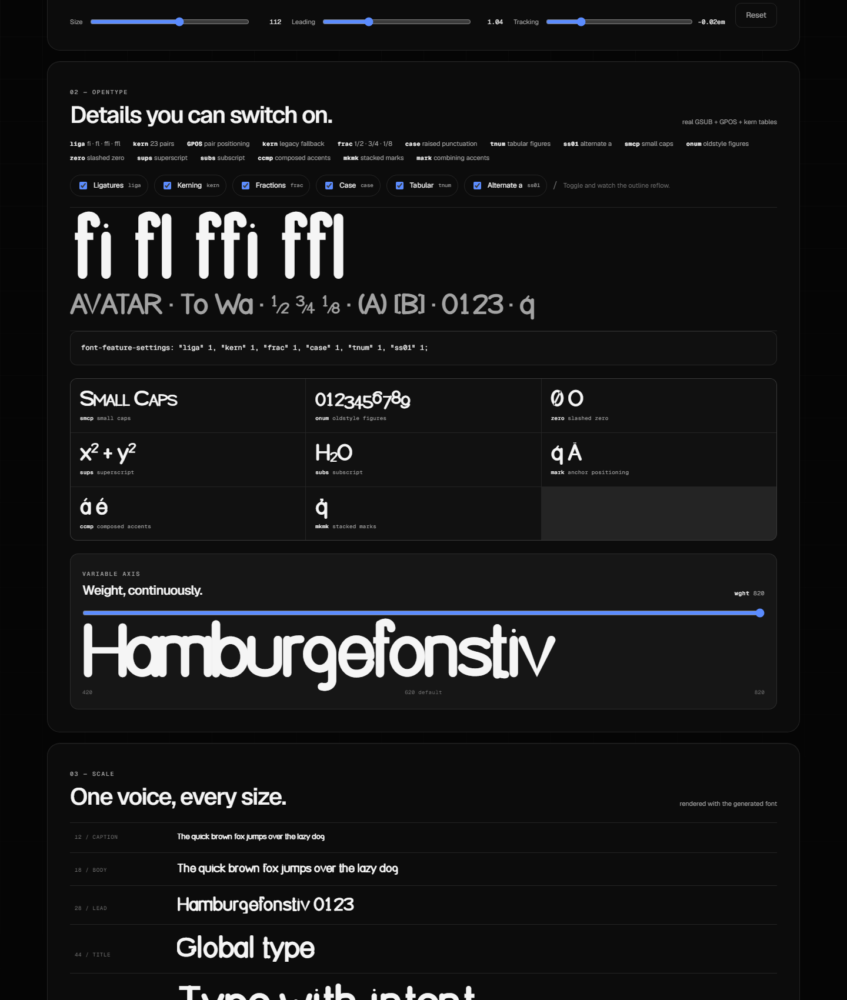

# fontcreator233

[](https://github.com/neko233-com/fontcreator233/actions/workflows/ci.yml)
[](https://go.dev/)
[](LICENSE)
[](assets/base/OFL.txt)

**A deterministic, offline font creator built for agents.**

You look at the reference image. fontcreator233 turns your visual decisions into
a real, installable typeface — plus a polished local specimen, packages for
Unity TMP, Unreal, the web, and your operating system, and app handoff guides
for Photoshop, 剪映/CapCut, Premiere, Figma, and Office.



```bash
fontcreator init --dir work --template geometric --family "Aurora Grotesk"
fontcreator build work/font.recipe.yaml --out dist --target all
```

No network at runtime. No LLM inside the binary. No font compiler installed.
Just Go, an OFL base font, and a recipe.

## Why it exists

- **Agent-native**: an external agent owns vision; the CLI exposes a strict
  JSON contract, JSON Schema, and an MCP server.
- **Deterministic**: fixed timestamps, seed-only randomness, sorted output,
  SHA-256 verification. `--jobs 1` and `--jobs 8` match on the same platform.
- **Multilingual**: parametric Latin/Greek/Cyrillic plus embedded OFL
  CJK/kana/Hangul/symbols. Global coverage is reported honestly, not claimed.
- **Real outputs**: TTF, WOFF, local HTML specimen, Unity UPM + TMP importer,
  Unreal import script + CompositeFont ranges, Web CSS with `unicode-range`,
  system install notes, and app handoff guides.
- **OpenType**: generated `liga`, `kern`, `case`, `frac`, `tnum`, `ss01`,
  `smcp`, `onum`, `zero`, `sups`, `subs`, `ccmp`, `calt`, and `mark`/`mkmk`
  anchors, plus GPOS and legacy kern tables. See
  [`docs/opentype.md`](docs/opentype.md).
- **Variable weight (opt-in)**: `output.variable: true` emits one real `wght`
  axis with `fvar` + `gvar`, plus `HVAR` advance-width and `MVAR` metric
  variation deltas; the specimen has a live weight slider.
- **Contextual rules**: `openType.contextual` maps any existing glyph sequence
  to any existing target glyph via a real GSUB chain-context lookup.
- **Cursive attachment (opt-in)**: `output.cursive: true` emits a real GPOS
  cursive attachment lookup (`curs`) with entry/exit anchors on lowercase
  letters; the specimen has a toggle and joined-glyph sample.
- **Color glyphs**: `openType.color` emits recipe-driven multi-glyph COLR v0
  with multiple CPAL palettes (circle/square/triangle/star/ring layers); the
  specimen has palette switches. Without it, one `U+E000` accent demo glyph is
  emitted.
- **Pleasant to use**: Bubble Tea TUI with progress, ETA, cancellation, and a
  plain/JSON fallback for automation.
- **Safe workspace**: builds stage and commit atomically; `clean` removes only
  scratch or state-tracked files whose SHA-256 still matches.

## Install

```bash
go install github.com/neko233-com/fontcreator233@latest
fontcreator version
```

Or build from source:

```bash
git clone https://github.com/neko233-com/fontcreator233
cd fontcreator233
go build -o fontcreator .
```

Requires Go 1.27+. Windows, macOS, and Linux. `CGO_ENABLED=0` is supported.

## The agent loop

```text
reference image
      │  agent vision
      ▼
style brief  →  recipe.yaml  →  validate  →  build  →  specimen  →  inspect
                                      ▲                              │
                                      └────────── iterate ◄──────────┘
```

Start with the contract:

```bash
fontcreator describe --json
```

Then:

```bash
fontcreator init --dir work --template geometric --family "My Typeface"
fontcreator validate work/font.recipe.yaml --json
fontcreator build work/font.recipe.yaml --out dist --target all --json --no-open
fontcreator specimen dist/MyTypeface-Regular.ttf --open
fontcreator inspect dist/MyTypeface-Regular.ttf --json
```

The agent-side mapping from visual signals to `weight`, `contrast`, `serif`,
`terminal`, `width`, `slant`, `tracking`, `roughness`, and `seed` is documented in
[`AGENTS.md`](AGENTS.md),
[`agent-skill/fontcreator233/SKILL.md`](agent-skill/fontcreator233/SKILL.md),
and [`docs/agent-workflow.md`](docs/agent-workflow.md).

### MCP

```json
{
  "mcpServers": {
    "fontcreator233": {
      "command": "fontcreator",
      "args": ["mcp"]
    }
  }
}
```

Tools: `fontcreator_describe`, `fontcreator_validate`, `fontcreator_build`,
`fontcreator_inspect`, `fontcreator_learn`, `fontcreator_specimen`,
`fontcreator_library_list`, `fontcreator_status`.

### Learn from an existing font

```bash
fontcreator learn path/to/reference.ttf --out work/learned --json
```

`learn` reads name records, metrics, cmap coverage, GSUB/GPOS feature tags,
lookup types, legacy kern pairs, variable axes, color tables, and sampled glyph
stats. It writes `font-report.json`, `font-report.md`, `profile.json`, and a
starter `recipe.yaml`. The generated recipe is a starting point, not a copy of
the source: inspect the original with your own vision before choosing skeleton,
contrast, serif, and terminals.

## Three example styles

| Recipe | Direction | What it demonstrates |
|---|---|---|
| [`aurora-grotesk`](examples/aurora-grotesk.recipe.yaml) | wide geometric sans, round terminals, weight 620 | modern poster/UI voice |
| [`noir-didone`](examples/noir-didone.recipe.yaml) | high-contrast hairline serif, 8° italic | editorial/Didone range |
| [`botanic-display`](examples/botanic-display.recipe.yaml) | flared terminals, organic jitter, seed 233 | Art Nouveau / display range |

```bash
fontcreator build examples/aurora-grotesk.recipe.yaml --target all --no-open
fontcreator build examples/noir-didone.recipe.yaml --target all --no-open
fontcreator build examples/botanic-display.recipe.yaml --target all --no-open
```

The automated E2E test builds all three with `common` coverage and asserts
glyph coverage, styles, determinism, specimen, and every platform package.

## Recipe

```yaml
apiVersion: fontcreator233/v1

meta:
  family: Aurora Grotesk
  style: Regular
  version: 1.0.0
  license: OFL-1.1
  accent: "#5B8CFF"

metrics:
  ascender: 810
  descender: -210
  xHeight: 0.52
  capHeight: 0.72

style:
  skeleton: geometric   # geometric | humanist | serif
  weight: 620           # 100–900
  width: 104            # 75–125
  slant: 0              # -15–15
  contrast: 0.06        # 0–1
  terminal: round       # flat | round | angled | flare
  serif: none           # none | slab | bracketed | hairline
  serifSize: 0
  roughness: 0          # deterministic via seed
  seed: 233

coverage:
  generated: [latin, greek, cyrillic]
  base:
    cjk: common         # none | sample | common | full
    kana: true
    hangul: true
    symbols: true

output:
  formats: [ttf, woff]
  targets: [universal, web, system, unity, unreal]
  specimen: true
  splitCJK: 0
  tmp:
    population: dynamic
    samplingPointSize: 90
    padding: 9
    atlasWidth: 1024
    atlasHeight: 1024
    multiAtlas: true
    renderMode: SDFAA
```

`fontcreator validate` is strict: unknown fields fail, ranges are checked, and
derived fonts must remain OFL-1.1. `fontcreator schema` prints the full JSON
Schema.

## Globalization

| Script | Source |
|---|---|
| Latin, Latin-1/Extended, Vietnamese | parametric + NFD composition |
| Greek | parametric + tonos composition |
| Cyrillic | parametric + composed Ё/Й/Ї/Ў |
| Simplified Chinese | embedded static Noto SC subset (actual cmap) |
| Japanese kana + common kanji | embedded SC base |
| Korean Hangul | embedded static Noto KR subset |
| Symbols, currency, arrows, punctuation | embedded base where available |

`coverage.base.cjk: full` means **all glyphs actually present in the embedded
bases**, not every Unicode block. The build JSON returns `coverageReport` with
requested/found/missing counts and warnings. Not supported: Arabic, Hebrew,
Indic scripts, Thai, vertical layout, complex shaping.

The embedded base fonts are derived from Noto Sans SC/KR at `wght=400` and are
licensed OFL-1.1. Generated fonts that use those outlines are OFL-1.1. See
[`NOTICE.md`](NOTICE.md) and [`assets/base/OFL.txt`](assets/base/OFL.txt).

## Outputs

```text
dist/
├─ AuroraGrotesk-Regular.ttf / .woff
├─ AuroraGrotesk-Regular.html
├─ AuroraGrotesk-Regular.glyphs.js
├─ fontcreator233.manifest.json
├─ OFL.txt
├─ Charsets/
├─ web/font.css
├─ system/INSTALL.md
├─ apps/           # Photoshop, 剪映/CapCut, Premiere, Figma, Office, …
├─ unity/          # UPM package + TMP importer + charsets
└─ unreal/         # Font import script + CompositeFont ranges
```

### Apps and editors

`apps/` is a ready-to-hand-off usage pack rather than a fake integration. It
ships the primary TTF in `apps/font/`, a single `README.md`, a machine-readable
`font-usage.json`, per-app guides, and `caption.srt` / `caption.ass` samples:



- **Adobe:** Photoshop, Illustrator, InDesign, Premiere Pro, After Effects.
- **Video:** 剪映 / CapCut, DaVinci Resolve, Final Cut Pro, OBS.
- **Design/docs:** Figma, Canva, Microsoft Office.
- **3D/engine:** Blender, Godot, Unity, Unreal.
- **Web/system:** local `font.css`, Windows/macOS/Linux install notes.

The TTF is the source of truth. Photoshop, Premiere, Resolve, Office, OBS, and
CapCut desktop use system-installed fonts; Figma desktop uses local fonts and
Figma web needs the Font Helper; Blender and Godot load the font file directly.
Mobile 剪映/CapCut builds vary, so the guide gives an import path and a
rendered-artwork fallback. Caption samples are safe for SRT workflows and ASS
styling. No app is launched or tested by the generator.

### Unity TMP

`unity/` is a UPM package. It requires TextMeshPro (Unity 2022.3) or uGUI/TMP
(Unity 6). Use `Tools/Fontcreator233/Create TMP Font Assets`,
`Create Static TMP Font Assets`, and `Wire Fallback Chain`. Dynamic multi-atlas
is the default; use `--split-cjk 4096` for mobile static atlases. The generator
does **not** launch or test Unity.

### Unreal

Run `unreal/Scripts/fontcreator233_import.py` inside the Unreal Editor Python
environment. It imports Font assets and attempts CompositeFont creation; when
the UE Python API does not expose it, it prints the exact ranges for manual
setup. No Unreal Editor test is run.

### Web

`web/font.css` uses local font files. Split fonts get `unicode-range`. WOFF2 is
not generated; run `woff2_compress` externally if you need it.

### System

`system/INSTALL.md` covers Windows, macOS, and Linux installation.

## Beautiful, offline specimen

The HTML is a Vercel/Geist-inspired review surface: a giant generated `Aa`,
editable type tester with size/leading/tracking, an OpenType feature playground
(liga, kern, frac, case, tnum, ss01, smcp, onum, zero, sups, subs, ccmp, mark,
mkmk), scale waterfall, multilingual coverage cards, an app/caption/poster
preview, and a virtualized glyph grid with search and script filters.



Everything is local:

- Geist Sans/Mono (OFL) for UI text.
- TanStack Virtual (MIT) bundled as a classic script, so `file://` works.
- No CDN, no ES modules, no `fetch()` for glyph data.
- Dark/light theme and accent from the recipe.
- `--self-contained-html` produces a single-file specimen.

See [`docs/web-specimen.md`](docs/web-specimen.md).

## CLI

```bash
fontcreator build <recipe> [--target all] [--split-cjk N] [--jobs N] [--json]
fontcreator build-all --dir examples [--font-jobs N]
fontcreator validate <recipe> --json
fontcreator inspect <font> --json
fontcreator learn <font> --out work/learned --json
fontcreator specimen <font> --open
fontcreator describe --json | --markdown
fontcreator schema
fontcreator init --template geometric|serif|display
fontcreator library list|export
fontcreator import font|bundle
fontcreator export glyphs|bundle
fontcreator status / clean
fontcreator mcp
```

Full reference: [`docs/cli.md`](docs/cli.md). Platform notes:
[`docs/platforms.md`](docs/platforms.md).

## Workspace and cleanup

Generated output is never committed (`.gitignore` ignores `dist/`, `work/`,
`out/`, `.fontcreator233/`, fonts outside `assets/base`, and specimen assets).
Every build stages under `.fontcreator233/tmp/` and commits atomically. State
records SHA-256, family, style, target, and time.

```bash
fontcreator status --out dist --json
fontcreator clean --out dist --dry-run          # scratch/history only
fontcreator clean --out dist --all --dry-run    # preview managed outputs
fontcreator clean --out dist --all --yes
fontcreator clean --out dist --target unity --yes
fontcreator clean --out dist --older-than 7d --yes
```

`clean` refuses to delete untracked or modified files unless `--force`.

## Testing

```bash
go test ./...
go test -short ./...          # skip the full three-style E2E
go test -race ./internal/parallel ./internal/workspace
```

Coverage includes geometry, recipe validation, outline generation, TTF/WOFF
encoding, Cmap/name/OS2 tables, base derivation, composition, parallel
determinism, workspace cleanup safety, SVG round-trips, bundles, MCP, CLI JSON,
and an E2E build of the three example styles with all platform packages.
Optional cross-checks use fontTools and `fc-scan` in CI.

## Limits

- No Arabic, Hebrew, Indic, Thai, vertical layout, or complex shaping.
- No SVG/sbix/CBDT color tables, emoji, or WOFF2 encoding.
- Generated OpenType covers `liga`, `kern`, `case`, `frac`, `tnum`, `ss01`,
  `smcp`, `onum`, `zero`, `sups`, `subs`, `ccmp`, simple top-center mark
  anchors, `mkmk` stacked marks, recipe-defined `calt` contextual rules, and
  opt-in `curs` cursive attachment (`output.cursive: true`, real GPOS type 3
  entry/exit anchors on lowercase letters). A single opt-in `wght` variable axis
  is emitted with `fvar` + `gvar` and `HVAR`/`MVAR` deltas; CJK/Hangul/kana stay
  static and no additional axes are generated. `openType.color` emits multi-glyph
  COLR/CPAL with multiple palettes. It does not generate contextual classes,
  backtrack/lookahead rules, or `cswh`. `learn` can report those features in
  other fonts.
- CJK/Hangul style transfer is geometric + synthetic bold, not a full redraw.
- Unity/Unreal packages are generated; validate them in your Editor.
- Builds are byte-identical within one tool version, OS/arch, and Go version.

## License

Code: MIT. Embedded base fonts and derived outputs: SIL OFL 1.1 — see
[`NOTICE.md`](NOTICE.md). Third-party UI assets: Geist (OFL), TanStack Virtual
(MIT) — see [`THIRD_PARTY_NOTICES.md`](THIRD_PARTY_NOTICES.md).
